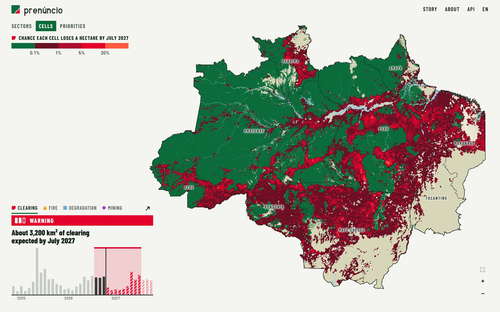

# Prenúncio

Prenúncio forecasts where the Brazilian Amazon will be cleared in the next PRODES year (August to July, the year INPE maps), for every 500 m cell of forest. The forecast and its replay over past years are at **[prenuncio.com](https://prenuncio.com)**. The code, the data pipeline and the benchmark are open, and anyone can submit a model.

[](https://prenuncio.com)

## How it works

- **Cells.** The forest is divided into 14 million squares of 500 m. Each one gets a chance of losing at least a hectare in the next PRODES year.
- **Inputs.** Eighteen years of public data: PRODES clearing since 2008, DETER alerts, Hansen and GLAD forest loss, JRC disturbance, AlphaEarth satellite embeddings, clearing permits, IBAMA notices and embargoes, fires, land tenure and climate indices. Everything a forecast for year T reads is dated before 31 July of T-1.
- **Model.** The annual forecast on the site comes from surveil-prenuncio-1, submitted by Henrique Godoy and SURVEIL. It combines LightGBM, XGBoost and a hurdle model on the 500 m grid. Cell probabilities are calibrated on earlier years.
- **Test.** The benchmark scores forecasts made using earlier years. Model development used results from the backtest years. The 5% of cells it ranks highest held 75.66% of the clearing in 2022 to 2025. Of the 500 places it listed first for 2024, 83% lost at least 10 hectares. Among cells assigned a 10 to 20% chance for 2024, 16% lost at least one hectare.
- **Sectors and priorities.** The cells add up to states, municipalities, Indigenous lands and conservation units, and to a ranked list of 500 places to inspect first.

## Leaderboard

<!-- leaderboard:start -->
The score is cap5, the share of the year's clearing inside the 5% of forest cells a model ranks highest, averaged over PRODES years 2022 to 2025.

| # | Model | cap5 | 2026 | By | Date | Links | Status |
|---|---|---:|---:|---|---|---|---|
| 1 | [surveil-prenuncio-1](benchmark/submissions/surveil-prenuncio-1/REPORT.md) | 75.7% | 75.3% | Henrique Godoy, SURVEIL Autonomous ML Swarm | 2026-11-23 | [code](https://github.com/gdavidss/prenuncio/tree/f667bee73a6ed0c1f68d8c465ec6cda320585d06) [maps](https://github.com/gdavidss/prenuncio/releases/tag/surveil-prenuncio-1) | re-scored |
| 2 | [prenuncio-3](benchmark/submissions/prenuncio-3/REPORT.md) | 75.1% | 74.3% | Prenúncio | 2026-11-16 | [code](https://github.com/gdavidss/prenuncio/tree/bfead815f2c8b41515230c46d66dd9f2d2204519) [maps](https://github.com/gdavidss/prenuncio/releases/tag/baseline-3) | re-scored |
| 3 | [prenuncio-2](benchmark/submissions/prenuncio-2/REPORT.md) | 74.5% | 73.5% | Prenúncio | 2026-11-16 | [code](https://github.com/gdavidss/prenuncio/tree/beafc85cb0897b44148987e2ea6db2edf78641f1) [maps](https://github.com/gdavidss/prenuncio/releases/tag/baseline-2) | re-scored, superseded |
| 4 | [prenuncio-1](benchmark/submissions/prenuncio-1/REPORT.md) | 72.5% | 72.7% | Prenúncio | 2026-11-15 | [code](https://github.com/gdavidss/prenuncio/tree/bb3f7f38e67442a2c3736ec73000a42faf3d58e3) [maps](https://github.com/gdavidss/prenuncio/releases/tag/baseline-1) | re-scored, superseded |
| 5 | [last-year-nearby](benchmark/submissions/last-year-nearby/REPORT.md) | 50.2% | 51.2% | Prenúncio | 2026-11-17 | [code](https://github.com/gdavidss/prenuncio/tree/0f3d250688c8ae8822dd9286b2b4ad5c86ea75de) [maps](https://github.com/gdavidss/prenuncio/releases/tag/reference-1) | reference |
<!-- leaderboard:end -->

2026 stays out of the mean because INPE has mapped it for its priority scenes only. Every year and the live track for 2027 are in [benchmark/LEADERBOARD.md](benchmark/LEADERBOARD.md).

## Try it

- **The site.** [prenuncio.com](https://prenuncio.com) shows the forecast for 2027, replays past years against what happened, and gives every forest cell a chance of being cleared.
- **The API.** Static JSON, described for agents at [prenuncio.com/llms.txt](https://prenuncio.com/llms.txt).
- **The scorer.** It needs numpy and scikit-learn and nothing else from this project.

```sh
python benchmark/score.py --selftest
python benchmark/score.py my_maps/      # downloads the truth files on first use
```

## Submit a model

1. Forecast 2022 to 2025 on the 500 m grid, each year from information up to 31 July of the year before. One model makes every map.
2. Score the maps with `python benchmark/score.py my_maps/`.
3. Upload them somewhere public, such as a GitHub release, Zenodo or Hugging Face.
4. Copy `benchmark/submissions/_template` to a folder with your model's name, fill in `meta.json` and `REPORT.md`, and run `python benchmark/submission.py fill <name> my_maps/ --url-base <where the maps are>`.
5. Open a pull request with that folder.

The rules fit on one screen in [benchmark/README.md](benchmark/README.md). Coding agents are welcome, and [AGENTS.md](AGENTS.md) is written for them. A forecast for 2027 registered by 31 December 2026 enters the live track and is scored when INPE publishes the map.

## Where things are

- `benchmark/` holds the rules, the scorer, the submissions and the leaderboard. [docs/BENCHMARK.md](docs/BENCHMARK.md) has the file formats and every definition.
- `pipeline/` is the tree model and everything that feeds the site. `unet/` is the convolutional network. [docs/PIPELINE.md](docs/PIPELINE.md) has the commands that rebuild the forecast.
- `web/` is the site, static, with no build step.
- [docs/RESULTS.md](docs/RESULTS.md) has every number, the weak ones included. The yearly total is still off by about a quarter.
- [docs/LAB.md](docs/LAB.md) is our lab notebook of what was tried. [docs/INPUTS.md](docs/INPUTS.md) is the ledger of inputs tested and proposed.
- [docs/RESEARCH.md](docs/RESEARCH.md) and [docs/POLICY.md](docs/POLICY.md) cover prior work and what the federal government did from 2023 on.
- [CONTRIBUTING.md](CONTRIBUTING.md) and [GOVERNANCE.md](GOVERNANCE.md) say how to contribute and who decides.

`data/` is not in git. `data/raw` holds IBAMA files with the names and tax numbers of people fined. Never commit or upload it.

## Licence and data

The code is under the [MIT licence](LICENSE). Submission folders are published under CC BY 4.0. The data belongs to its producers, and anything built from it must credit them.

- **PRODES and DETER**, INPE, through [TerraBrasilis](https://terrabrasilis.dpi.inpe.br), CC BY-SA 4.0. The benchmark's truth files are derived from PRODES and carry the same licence.
- **Active fire detections**, INPE Programa Queimadas.
- **Global Forest Change**, Hansen, Potapov, Moore, Hancher et al., University of Maryland, Google, USGS and NASA, CC BY 4.0. Hansen et al. 2013, Science 342, 850 to 853.
- **GLAD Sentinel-2 forest disturbance alerts**, GLAD laboratory, University of Maryland.
- **Tropical Moist Forest** disturbance record, European Commission Joint Research Centre. Vancutsem et al. 2021, Science Advances 7, eabe1603.
- **AlphaEarth Foundations Satellite Embedding**, CC BY 4.0. The AlphaEarth Foundations Satellite Embedding dataset is produced by Google and Google DeepMind.
- **Embargoes, infraction notices and clearing permits**, IBAMA open data.
- **Oceanic Niño Index and tropical North Atlantic index**, NOAA.
- **Indigenous lands, conservation units, municipalities and states**, FUNAI, MMA and IBGE, as distributed by INPE.
- **Satellite imagery on the site**, Esri World Imagery (Esri, Maxar, Earthstar Geographics), under Esri's terms of use.

Prenúncio is an independent project, made by [Gui Dávid](https://guidavid.com) as an initiative of Movimento Cibernético Brasileiro. It does not replace INPE's official figures and has no tie to the institutions above.

## Em português

O Prenúncio prevê onde a Amazônia Legal vai ser desmatada no próximo ano PRODES, em cada célula de 500 m de floresta. A previsão e a reprise dos anos passados estão em [prenuncio.com](https://prenuncio.com). O código e o benchmark são abertos. Para entrar no benchmark acima, envie por pull request um modelo com as notas, o código e um relatório, seguindo as regras de [benchmark/README.md](benchmark/README.md). Agentes de IA são bem-vindos, desde que o relatório diga qual foi usado e como. O Prenúncio é um projeto independente e não substitui os números oficiais do INPE. Feito por [Gui Dávid](https://guidavid.com), uma iniciativa do Movimento Cibernético Brasileiro.
